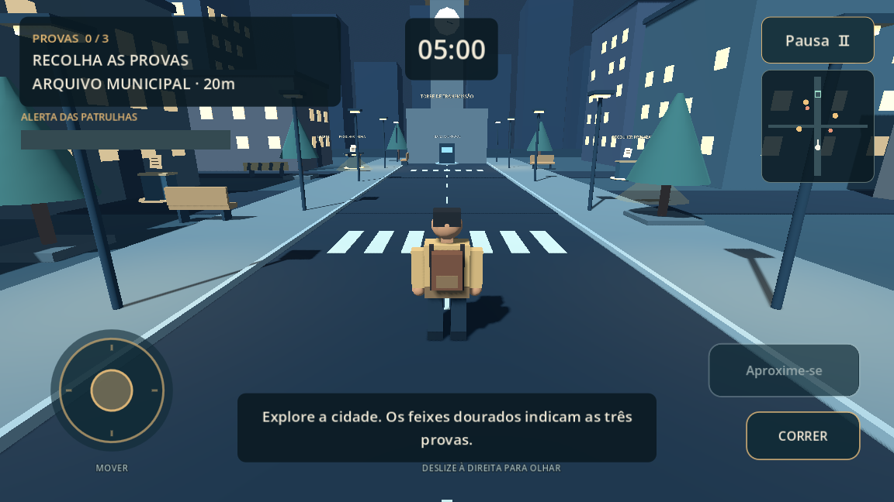

# O Último Dia da Democracia

**Protótipo 3D em terceira pessoa para Android**, em português, feito com Godot 4.6.3 e GDScript. Você controla um repórter nas ruas de Aurora, com movimentação livre e câmera atrás do personagem. Funciona offline, sem navegador ou WebView.

## A missão em terceira pessoa

Faltam cinco minutos para a meia-noite. Explore Aurora, reúna três provas e leve o dossiê ao terminal da torre de transmissão. Os documentos estão no Arquivo Municipal, na estação de rádio e na última redação. Drones patrulham a região: mantenha distância ou use os edifícios como cobertura para reduzir o alerta.

O protótipo inclui personagem com animação de caminhada e corrida, colisões, câmera orbital com prevenção de atravessamento de paredes, mapa, objetivos, patrulhas, prazo, pausa e salvamento local da posição e do progresso. É uma pequena área de exploração jogável, ainda em desenvolvimento.



É um protótipo jogável original. O cenário e os personagens são fictícios.

## Baixar no celular

[Baixar APK v0.2.0 — terceira pessoa](https://github.com/BBPACHECO/O_Ultimo_Dia_Da_Democracia/raw/refs/heads/main/downloads/o-ultimo-dia-v0.2.0.apk)

Abra o link no celular, baixe o arquivo e toque nele para instalar. Se o Android solicitar, autorize a instalação para o aplicativo usado para abrir o APK. Compatível com Android 7.0 ou superior, ARMv7/ARM64 e OpenGL ES 3.0. O jogo funciona offline depois de instalado. A assinatura é de desenvolvimento.

O APK e seu checksum SHA-256 ficam na pasta [`downloads/`](downloads/). Use o celular **na horizontal**. A versão 0.2.0 usa a mesma assinatura e aumenta o código de versão, permitindo atualizar a 0.1.0 sem desinstalar. A instalação e o desempenho em um aparelho físico ainda precisam ser verificados.

| Ação | Celular | Computador |
| --- | --- | --- |
| Andar | Joystick à esquerda | WASD ou setas |
| Olhar | Arrastar à direita | Segurar mouse direito e mover; Q/R também giram |
| Correr | Segurar **CORRER** com outro dedo | Shift |
| Recolher / transmitir | Aproximar e tocar no botão de ação | E |
| Pausar | **Pausa** ou Voltar do Android | Esc |

Joystick, câmera e botões aceitam dedos independentes. Ao pausar ou trocar de aplicativo, o relógio e as patrulhas param. **Continuar missão** retoma posição, provas, prazo e alerta.

## Desenvolver

Abra `project.godot` no **Godot 4.6.3 estável**, edição padrão (não precisa de .NET), e pressione F5. A cena inicial é `scenes/third_person.tscn`, em orientação horizontal. O jogo instalado usa a interface e o renderizador nativos do engine.

No ambiente de nuvem Linux, o Godot e o Java 21 já estão disponíveis:

```bash
cd /workspace/O_Ultimo_Dia_Da_Democracia
bash tools/setup_android.sh
bash tools/test.sh
bash tools/build_android.sh
```

Os scripts usam `/workspace/.tools/democracia` para SDK, templates, configurações e caches, sem gravar no diretório pessoal do usuário. É possível escolher outro diretório com `GAME_TOOL_ROOT`. Não é necessário npm, servidor HTTP, Gradle ou compilação do engine. A exportação usa templates Android oficiais pré-compilados; por isso, não exige NDK nem CMake. Os downloads têm seus checksums verificados e as conexões mantêm a verificação TLS.

Para abrir o editor em uma sessão Linux com tela:

```bash
source tools/env.sh
godot --path "$PROJECT_ROOT" --editor
```

## Instalar no Android

O build gera `builds/o-ultimo-dia-debug.apk`, compatível com Android 7.0 ou superior e celulares ARM de 32 e 64 bits com OpenGL ES 3.0. Copie o APK para seu aparelho e autorize a instalação para o aplicativo usado para abri-lo. Alternativamente, **no seu computador**, com Android Platform Tools instalado, aparelho conectado e depuração USB autorizada:

```bash
adb install -r builds/o-ultimo-dia-debug.apk
```

É uma versão de desenvolvimento com assinatura de depuração. Publicar na Play Store exige uma chave de lançamento própria e um build AAB, além da preparação da ficha da loja; isso não faz parte deste protótipo. Não inclua keystores de lançamento no Git.

O preset deixa a execução automática por USB no editor desativada (`runnable=false`), para não procurar aparelhos durante a compilação na nuvem. Isso não afeta o ícone nem a execução do aplicativo instalado. A instalação e o uso em um aparelho físico ainda precisam ser verificados.

## Organização

- `scripts/game_3d.gd`: missão, interface e pausa.
- `scripts/player_3d.gd`: personagem físico, animação e câmera.
- `scripts/touch_controls.gd`: joystick, câmera e ações com multitoque.
- `scripts/city_world.gd`: cenário original, colisões e patrulhas.
- `scripts/mission_state.gd`: regras e salvamento validado.
- `scripts/radar_3d.gd`: mapa do jogador, objetivos e patrulhas.
- `tests/test_3d.gd`: regras, persistência, física, multitoque, pausa e missão completa.
- `tools/`: instalação reproduzível, testes, exportação e verificação do APK.

O salvamento 3D fica em `user://mission_3d_v2.json`, no armazenamento privado do aplicativo. Os testes usam arquivos separados do progresso do jogador. `builds/` e `.godot/` são saídas locais ignoradas pelo Git.

A imagem acima é uma captura real do engine usando OpenGL por software, sem navegador. `tools/capture_screens.gd` pode repetir a inspeção em uma sessão gráfica. As fontes DejaVu são acompanhadas de sua licença, incluída no APK.

Os arquivos da versão 0.1.0 de alternativas permanecem como código legado, mas não são a experiência principal da versão 0.2.0.
