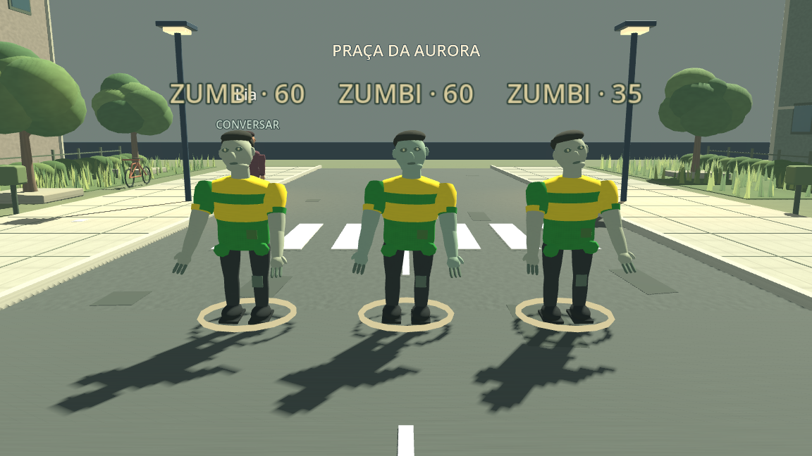
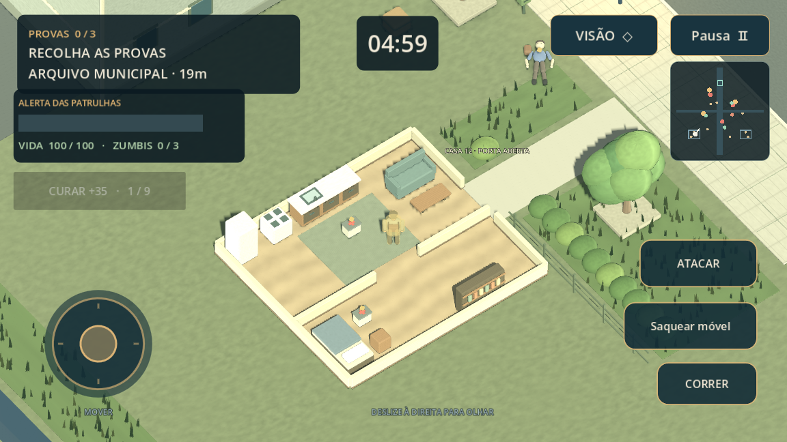
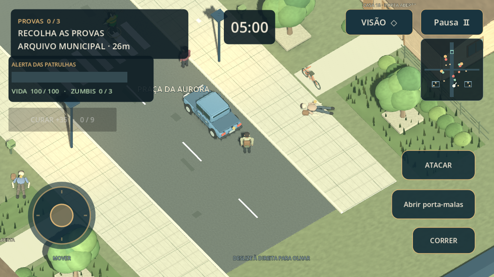
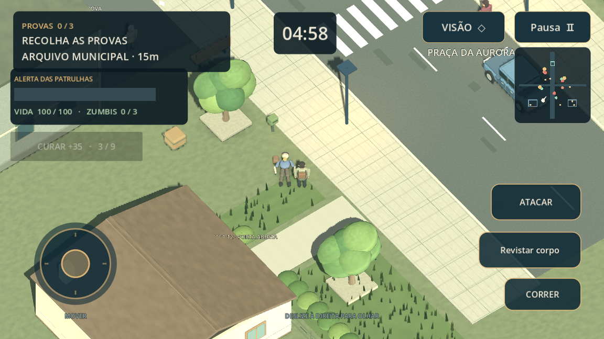
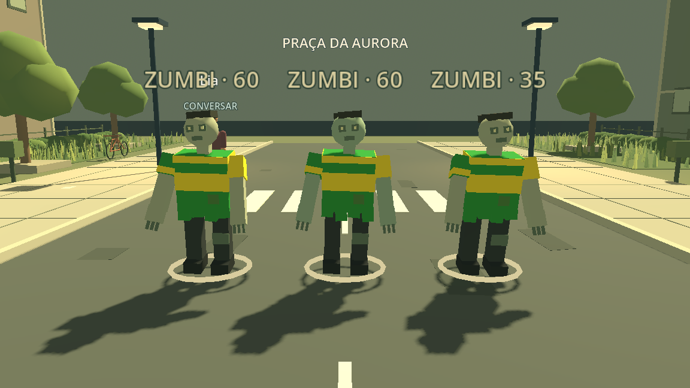
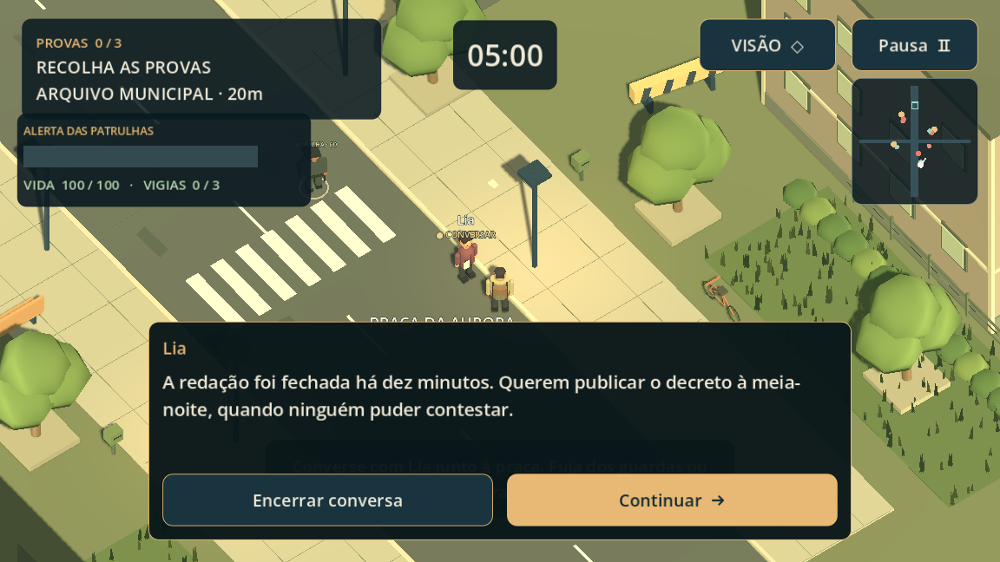
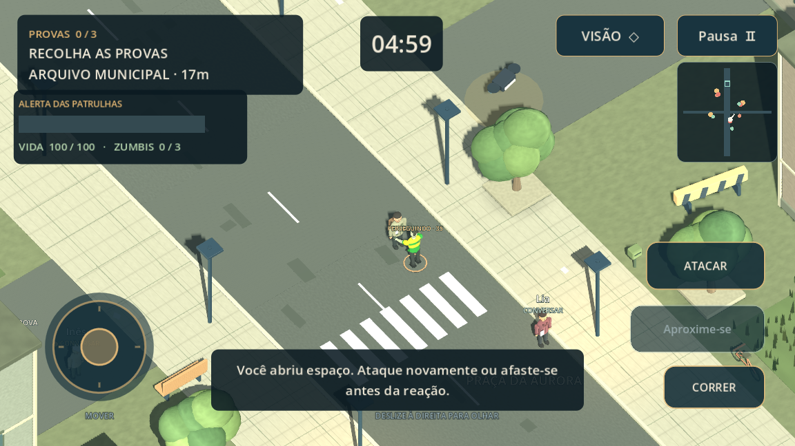

# O Último Dia da Democracia

**Jogo 3D de exploração e ação para Android**, em português, feito com Godot 4.6.3 e GDScript. Você controla um repórter nas ruas de Aurora, conversa com sobreviventes e enfrenta ou evita zumbis com camisas verdes e amarelas para reunir provas. A câmera em três quartos, a paleta e a vegetação foram inspiradas na referência visual de Project Zomboid, com arte original. O botão **VISÃO** alterna para a câmera de terceira pessoa mais próxima. Funciona offline, sem navegador ou WebView.

## A missão em terceira pessoa

Faltam cinco minutos para a meia-noite. Explore Aurora, reúna três provas e leve o dossiê ao terminal da torre de transmissão. Os documentos estão no Arquivo Municipal, na estação de rádio e na última redação. Drones patrulham a região: mantenha distância ou use os edifícios como cobertura para reduzir o alerta.

O protótipo inclui caminhada, corrida, combate corpo a corpo, saúde, três zumbis com camisas verdes e amarelas que vagam, perseguem e atacam, drones, três sobreviventes com diálogos contextuais, mapa, prazo, pausa e salvamento local. Paredes bloqueiam ataques e a visão dos inimigos. É uma pequena área de exploração jogável, ainda em desenvolvimento.




É um protótipo jogável original. O cenário e os personagens são fictícios.

## Baixar no celular

[Baixar APK v0.5.0 — casas, loot, corpos e carros](https://github.com/BBPACHECO/O_Ultimo_Dia_Da_Democracia/raw/refs/heads/main/downloads/o-ultimo-dia-v0.5.0.apk)

Abra o link no celular, baixe o arquivo e toque nele para instalar. Se o Android solicitar, autorize a instalação para o aplicativo usado para abrir o APK. Compatível com Android 7.0 ou superior, ARMv7/ARM64 e OpenGL ES 3.0. O jogo funciona offline depois de instalado. A assinatura é de desenvolvimento.

O APK e seu checksum SHA-256 ficam na pasta [`downloads/`](downloads/). Use o celular **na horizontal**. A versão 0.5.0 usa a mesma assinatura e aumenta o código de versão, permitindo atualizar a 0.4.0 sem desinstalar. O progresso anterior é preservado. Para encontrar todos os zumbis ativos, inicie uma nova missão; inimigos já derrotados no save continuam derrotados. A fase 1 da versão 0.2.0 foi testada e aprovada pelo usuário no celular; esta atualização ainda precisa desse teste de desempenho no aparelho.

## Casas e loot na versão 0.5.0

Duas casas de porta aberta ficam nos lados da praça inicial (casas 12 e 18). Entre pelos caminhos de pedra: o telhado e a parte alta das paredes desaparecem ao se aproximar, mostrando cozinha, sala e quarto. Os móveis continuam físicos. O mapa mostra o contorno das casas e pequenos pontos âmbar indicam loot ainda disponível.

Há **10 pontos de saque**: quatro nas casas, três porta-malas de carros abandonados e três corpos com bolsas ou suprimentos. Aproxime-se do marcador âmbar e use **Saquear móvel**, **Abrir porta-malas** ou **Revistar corpo**. Cada local rende uma ou duas unidades e só pode ser saqueado uma vez por missão. Paredes bloqueiam o saque. Os carros são obstáculos e fontes de loot; ainda não são dirigíveis.

A mochila comporta até **9 suprimentos**. Toque em **CURAR +35** (H no computador) para consumir uma unidade e recuperar até 35 de vida. Com a saúde completa, o botão fica desativado. O inventário e os locais já saqueados são salvos; os saves anteriores migram automaticamente, preservando a missão.



| Porta-malas | Corpo com suprimentos |
| --- | --- |
|  |  |

## Gráficos suavizados

Personagens agora usam superfícies curvas e perfis de ombros/cintura, com rostos, cabelo, mãos, sapatos e roupas arredondados. As camisas verdes e amarelas dos zumbis foram preservadas. Árvores têm copas orgânicas; fachadas, asfalto, calçadas e objetos usam texturas discretas e bordas suavizadas. A iluminação foi equilibrada e o modo Suave usa antisserrilhamento 2x.

No menu inicial ou na pausa, **Gráficos: Suave / Leve** alterna a qualidade e salva sua preferência. Suave mantém o antisserrilhamento e as sombras principais; Leve desliga esses dois efeitos para reduzir o custo de renderização, mantendo os modelos e as texturas novos. O resultado continua estilizado, sem pretensão de fotorrealismo.

### Comparação real no engine

| Versão 0.3.1 | Versão 0.4.0 |
| --- | --- |
|  |  |
|  |  |

As imagens são capturas nativas, com os mesmos personagens e enquadramentos. Foram conferidas com OpenGL por software no host; não representam uma medição de FPS no celular. A geometria e as pequenas texturas originais ficam em cache, e vegetação/janelas continuam agrupadas para limitar o custo.

| Ação | Celular | Computador |
| --- | --- | --- |
| Andar | Joystick à esquerda | WASD ou setas |
| Olhar | Arrastar à direita | Segurar mouse direito e mover; Q/R também giram |
| Correr | Segurar **CORRER** com outro dedo | Shift |
| Recolher / transmitir | Aproximar e tocar no botão de ação | E |
| Conversar | Aproximar de Lia, Inês ou Tomás e tocar **Falar** | E; E também avança a conversa |
| Atacar | Tocar **ATACAR**, de frente e perto do zumbi | Espaço |
| Saquear | Aproximar do marcador e usar o botão de ação | E |
| Curar | **CURAR +35** com suprimentos e vida abaixo de 100 | H |
| Alternar câmera | **VISÃO** | F |
| Pausar | **Pausa** ou Voltar do Android | Esc |

Joystick, câmera e botões aceitam dedos independentes. Recue quando um zumbi preparar o ataque e golpeie para interrompê-lo. Cada golpe tem intervalo; inimigos fora de alcance, atrás do personagem ou de paredes não são atingidos.

Ao pausar, conversar ou trocar de aplicativo, o relógio e os inimigos param. **Continuar missão** retoma posição, provas, prazo, alerta, saúde, conversas concluídas, inimigos derrotados, suprimentos e locais saqueados. Concluir a primeira conversa com Lia recupera até 20 de saúde; Tomás reduz o alerta. Esses benefícios acontecem uma única vez por missão.





## Desenvolver

Abra `project.godot` no **Godot 4.6.3 estável**, edição padrão (não precisa de .NET), e pressione F5. A cena inicial é `scenes/third_person.tscn`, em orientação horizontal. O jogo instalado usa a interface e o renderizador nativos do engine.

No ambiente de nuvem Linux, o Godot e o Java 21 já estão disponíveis:

```bash
cd /workspace/O_Ultimo_Dia_Da_Democracia
bash tools/setup_android.sh
bash tools/test.sh
bash tools/build_android.sh
```

Os scripts usam `/workspace/.tools/democracia` para SDK, templates, configurações e caches, sem gravar no diretório pessoal do usuário. É possível escolher outro diretório com `GAME_TOOL_ROOT`. Não é necessário npm, servidor HTTP, Gradle ou compilação do engine. A exportação usa templates Android oficiais pré-compilados; por isso, não exige NDK nem CMake. Os downloads têm seus checksums verificados e as conexões mantêm a verificação TLS.

Para abrir o editor em uma sessão Linux com tela:

```bash
source tools/env.sh
godot --path "$PROJECT_ROOT" --editor
```

## Instalar no Android

O build gera `builds/o-ultimo-dia-debug.apk`, compatível com Android 7.0 ou superior e celulares ARM de 32 e 64 bits com OpenGL ES 3.0. Copie o APK para seu aparelho e autorize a instalação para o aplicativo usado para abri-lo. Alternativamente, **no seu computador**, com Android Platform Tools instalado, aparelho conectado e depuração USB autorizada:

```bash
adb install -r builds/o-ultimo-dia-debug.apk
```

É uma versão de desenvolvimento com assinatura de depuração. Publicar na Play Store exige uma chave de lançamento própria e um build AAB, além da preparação da ficha da loja; isso não faz parte deste protótipo. Não inclua keystores de lançamento no Git.

O preset deixa a execução automática por USB no editor desativada (`runnable=false`), para não procurar aparelhos durante a compilação na nuvem. Isso não afeta o ícone nem a execução do aplicativo instalado. A instalação e o uso em um aparelho físico ainda precisam ser verificados.

## Organização

- `scripts/game_3d.gd`: missão, interface e pausa.
- `scripts/art_geometry.gd`: geometria suavizada compartilhada, materiais e texturas originais de 128 px.
- `scripts/player_3d.gd`: personagem físico, animação e câmera.
- `scripts/touch_controls.gd`: joystick, câmera e ações com multitoque.
- `scripts/city_world.gd`: cenário original, colisões e patrulhas.
- `scripts/mission_state.gd`: regras, inventário e salvamento validado.
- `scripts/house_interior.gd`: casas exploráveis, móveis e corte visual do telhado.
- `scripts/scavenge_props.gd`, `scripts/loot_catalog.gd`: carros, corpos e pontos estáveis de saque.
- `scripts/radar_3d.gd`: mapa do jogador, objetivos e patrulhas.
- `scripts/enemy_guard.gd`: zumbis, perseguição, ataques, recuo e derrota; o nome histórico do arquivo foi mantido para compatibilidade.
- `scripts/citizen_npc.gd`, `scripts/dialogue_book.gd` e `data/dialogues.json`: moradores e conversas contextuais.
- `tests/test_3d.gd`: regras, persistência, física, multitoque, pausa e missão completa.
- `tests/test_action.gd`: combate, paredes, saúde, diálogo, câmera e migração de saves.
- `tests/test_loot.gd`: saque, cura, mochila, persistência, migração e acesso físico às casas.
- `tools/`: instalação reproduzível, testes, exportação e verificação do APK.

O salvamento 3D fica em `user://mission_3d_v2.json`, no armazenamento privado do aplicativo. Os testes usam arquivos separados do progresso do jogador. `builds/` e `.godot/` são saídas locais ignoradas pelo Git.

A imagem acima é uma captura real do engine usando OpenGL por software, sem navegador. `tools/capture_screens.gd` pode repetir a inspeção em uma sessão gráfica. As fontes DejaVu são acompanhadas de sua licença, incluída no APK.

Os arquivos da versão 0.1.0 de alternativas permanecem como código legado, sem participar da experiência principal. A fase 1, os diálogos, o combate e os zumbis foram preservados. A 0.5.0 preserva os gráficos suavizados e acrescenta casas, corpos, carros e suprimentos.
